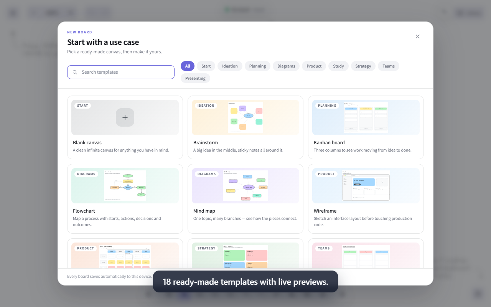
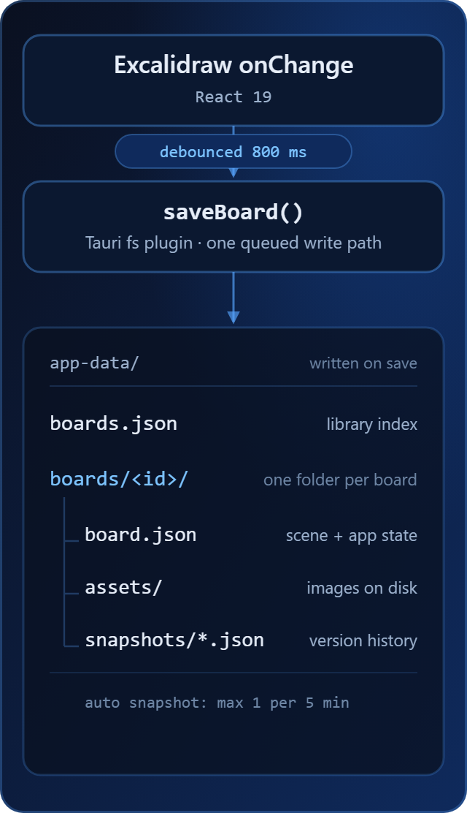
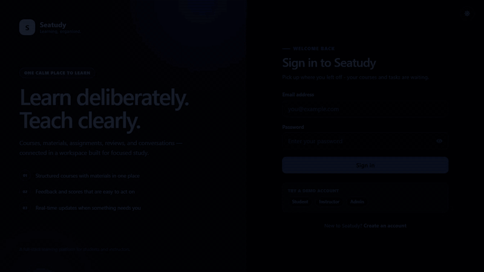

  <picture>
    <source media="(prefers-color-scheme: dark)" srcset="assets/banner-dark.svg">
    
  </picture>

I'm a computer science student who likes owning a project end to end: the interface, the data layer, and the part that has to keep working when the network doesn't. Most of my work is TypeScript and Node, with C, Python, Java and Lua for everything else.

## Things I've built

**[Canvas App](https://github.com/IniEyyy/canvas-app)**
A local-first whiteboard workspace for the desktop: named boards with tags, automatic version history, cross-board links, Markdown export, 18 templates, and a one-click mind-map layout. Everything autosaves to files on your machine — no account and no connection needed. MIT licensed.
`Tauri v2` · `React 19` · `Excalidraw`

  

  45-second walkthrough · <a href="https://github.com/IniEyyy/canvas-app/blob/main/docs/canvas-trailer.mp4">full-quality MP4</a> · <a href="https://github.com/IniEyyy/canvas-app">view code</a>

How it saves your work

  

One queued save path behind the debounce, so a slow disk cannot race the
next write. On desktop everything stays in the app-data folder: `boards.json`
indexes the library, each board keeps its own scene and snapshots, and images
are written to `assets/` instead of base64 inside the scene. In browser dev,
the same index, scenes, and snapshots go to `localStorage`.

**[Seatudy](https://github.com/IniEyyy/seatudy)**
An online learning platform with role-based access, JWT auth and real-time features.
`React` · `Vite` · `Node.js` · `Express` · `PostgreSQL` · `Socket.IO`

  

  Dark-mode walkthrough · <a href="https://github.com/IniEyyy/seatudy/blob/main/docs/preview.mp4">full-quality MP4 (22s)</a>

**[Jomoro Koffee](https://github.com/IniEyyy/SA)**
A system architecture project built as NestJS microservices.
`NestJS` · `Microservices`

**[Growlauncher Documentation](https://github.com/IniEyyy/Growlauncher-Documentation)** &nbsp; 
API documentation for a Lua scripting tool, put together by testing each function by hand.
`Lua`

**[ML Energy Experiment](https://github.com/IniEyyy/ML-Energy-Experiment)**
An academic research experiment.

## Right now

- Extending Canvas App: PDF export, media overlays, performance
- Finishing my portfolio site

## Stack

  
  
  
  
  
  

  
  
  
  
  

  
  
  
  
  

## How I work

I use AI coding agents for implementation. The architecture, the trade-offs and the review are still mine.

Issues and discussions are open on every repo above.
